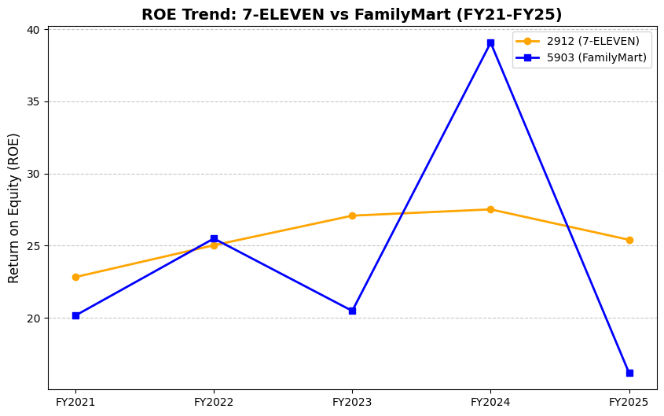
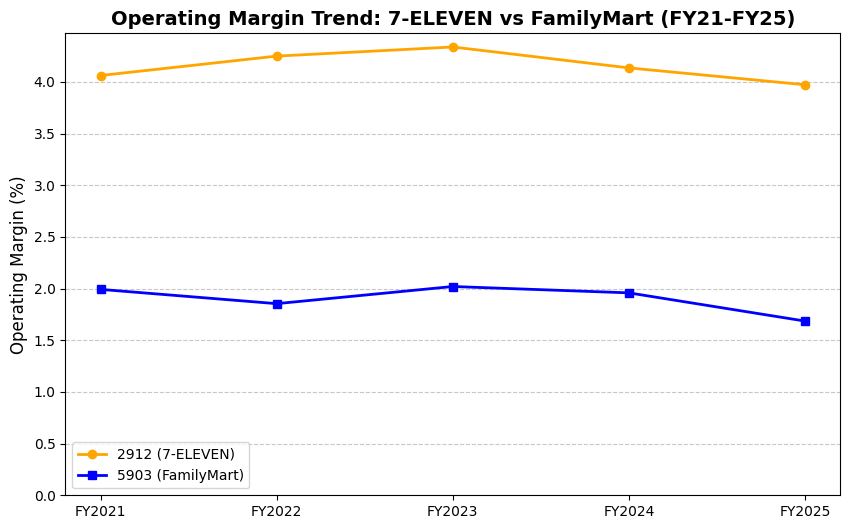
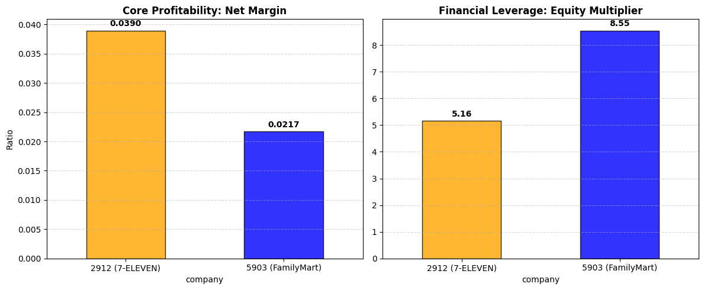
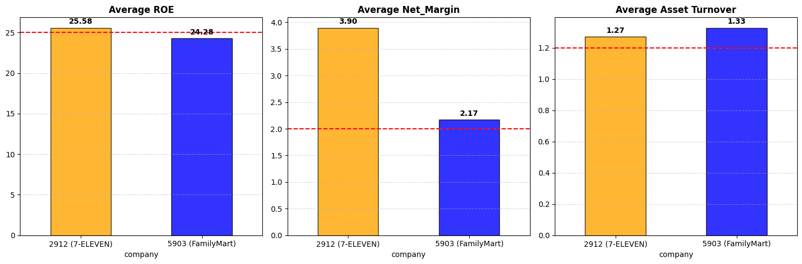

# 🇹🇼 Taiwan Retail Duopoly: Financial & Strategic Analysis
**President Chain Store (7-ELEVEN) vs. Taiwan FamilyMart (FY2021–FY2025)**


## 📌 Project Overview
This project provides a comprehensive, data-driven financial and strategic evaluation of Taiwan's convenience store duopoly—**President Chain Store Corporation (2912, 7-ELEVEN)** and **Taiwan FamilyMart (5903)**. 

Using 5-year historical financial data sourced from the Market Observation Post System (MOPS), this analysis goes beyond basic ratios. It implements **automated DuPont analysis** and **dynamic stress-testing models** across four distinct stakeholder perspectives (Creditor, Investor, Vendor, and Management) to uncover the hidden strategic differences between the two retail giants.

---

## 🚀 Key Features & Methodology

### 1. Data Validation & Preprocessing
* Automated balance sheet integrity checks ($Assets = Liabilities + Equity$) and gross profit verifications across 10 fiscal years to ensure data reliability before analysis.

### 2. DuPont Analysis (Strategic Drivers)
* Deconstructs Return on Equity (ROE) into **Net Profit Margin**, **Asset Turnover**, and **Equity Multiplier** to expose contrasting business models (Core Profitability vs. Financial Leverage).

### 3. Multi-Stakeholder Decision Models & Stress Testing
Built custom Python functions to evaluate companies based on dynamic thresholds, outputting automated strategic ratings:
* **🏦 Bank (Creditor)**: Evaluates Interest Coverage, Debt Ratio, and Current Ratio. (Base Threshold: 7x Interest Coverage)
* **📈 Long-Term Investor**: Evaluates ROE, Net Margin, and Asset Turnover. (Base Threshold: $ROE \ge 25\%$)
* **🚚 Supplier (Vendor)**: Analyzes Payable Days and Cash Ratio. Features a dual-condition liquidity warning. (Base Threshold: Net-60 terms & Cash Ratio > 0.3)
* **🏢 Manager (Operations)**: Assesses Return on Assets (ROA) and Operating Margin. (Base Threshold: $ROA \ge 6\%$)

---

## 💡 Core Insights & Summary of Findings

* **Core Profitability vs. Leverage (The ROE Illusion)**: 
  Both companies achieve impressive equity returns, but through completely different drivers. **7-ELEVEN (2912)** generates a 5-year average ROE of **25.58%** driven by superior core operational efficiency (Net Margin: **3.90%**, ROA: **4.96%**). In contrast, **FamilyMart (5903)** achieves a comparable ROE of **24.28%** by relying heavily on financial leverage, utilizing an extreme equity multiplier of 8.55 to compensate for its thinner margins (Net Margin: 2.17%, ROA: 2.89%).

* **Supply Chain Bargaining Power**: 
  Under standard Net-60 commercial terms, 7-ELEVEN qualifies as a **"prompt payer"** with an average payment cycle of 53.02 days. FamilyMart, stretching payments to 71.54 days with a mere 0.19 cash ratio, is downgraded to a **"slow payer"** and triggers a systemic **"thin cash"** liquidity warning.

* **Ultimate Verdict**: 
  While both retailers dominate the market, **7-ELEVEN (2912)** is the structurally safer and more profitable holding across all four stakeholder stress tests.

---

## 📊 Visualizing the Financial Insights

To provide a clear picture of the duopoly's dynamics, the following visualizations map out their 5-year trajectories, strategic differences, and stress-test performance.

### 1. The 5-Year Trajectory: ROE vs. Operating Margin
While FamilyMart's ROE fluctuates wildly and eventually drops, 7-ELEVEN maintains a steady and premium return on equity. Looking at the Operating Margin, the core reason becomes clear: 7-ELEVEN consistently extracts double the operational profit from its revenue compared to FamilyMart.




### 2. DuPont Analysis: Deconstructing the ROE Illusion
Why did FamilyMart's ROE occasionally catch up to 7-ELEVEN despite its poor margins? The DuPont analysis reveals the truth: 7-ELEVEN relies on strong core profitability (Net Margin), whereas FamilyMart artificially boosts its ROE using massive financial leverage (Equity Multiplier > 8.5x).



### 3. Long-Term Investor Assessment (Stress Testing)
Implementing a strict dual-condition threshold: requiring a minimum **25% ROE** (red dashed line) alongside a **2.0% Net Margin**. 7-ELEVEN safely clears the benchmark as a strong "Buy", while FamilyMart fails the 25% equity return test, dropping to a "Hold".



---

## 🛠️ How to Run the Project

1. Clone the repository:
   ```bash
   git clone [https://github.com/Junl1993/Retail-Financial-Analysis-TW.git](https://github.com/Junl1993/Retail-Financial-Analysis-TW.git)
